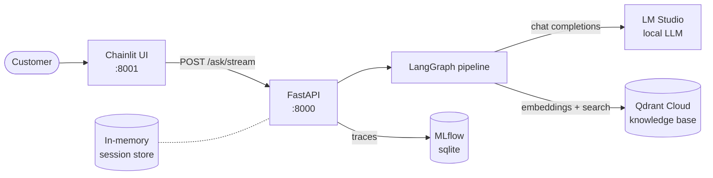
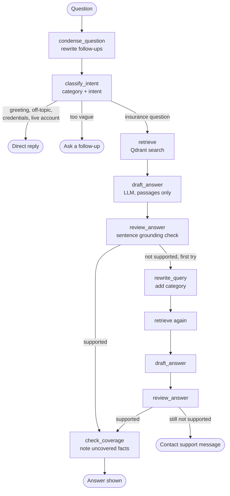

# Insurance Support Bot

A customer-support chatbot for insurance questions. It answers only from a curated help knowledge base, checks every answer against the source passages before showing it, and falls back to a "contact support" message when it cannot find a reliable answer.

Built as Experiment 7 of the SEM7 lab series.

## Architecture



## Answer flow

Each question goes through this LangGraph pipeline:



Key points:

- **Grounding:** every drafted sentence must be similar to a retrieved passage (`GROUNDING_MIN`). Numbers and fees that no passage states are blocked.
- **One retry:** the query is rewritten and searched again once (`MAX_RETRIES`).
- **Memory:** each session keeps a short sliding window of recent messages (`MAX_HISTORY_MESSAGES`). Card-like numbers are masked before they reach the LLM.

## Requirements

- Python 3 and [uv](https://docs.astral.sh/uv/)
- [LM Studio](https://lmstudio.ai/) running a local chat model with its OpenAI-compatible server enabled
- A [Qdrant Cloud](https://cloud.qdrant.io/) cluster (URL and API key)
- Internet access the first time `scripts.ingest` runs, to download the dataset and embedding model

## Setup

### 1. LM Studio

1. Load a chat model. Set **Context Length** to at least 4096.
2. Open the **Developer** tab and start the server.
3. Copy the model identifier into `LLM_MODEL` and the server address into `LLM_BASE_URL` in `api/.env`.
   The default address is `http://localhost:1234/v1`.

### 2. API (folder: `api/`)

```bash
cd api
uv venv .venv
.venv\Scripts\activate              # Windows (macOS/Linux: source .venv/bin/activate)
uv pip install -r requirements.txt
cp .env.example .env                # then fill in the values listed below
uv run python -m scripts.ingest     # run once: builds the Qdrant collection and writes data/taxonomy.json
uv run uvicorn app.main:app --host 127.0.0.1 --port 8000
```

Swagger UI: http://127.0.0.1:8000/docs

Required values in `api/.env`:

| Variable | Purpose |
|---|---|
| `LLM_BASE_URL`, `LLM_MODEL` | LM Studio server address and model identifier |
| `QDRANT_URL`, `QDRANT_API_KEY` | Qdrant Cloud cluster |
| `COLLECTION` | Qdrant collection name (default `insurance_support_bot`) |
| `API_KEY` | Optional. If set, every request must send an `X-API-Key` header |

`scripts.ingest` **drops and rebuilds** the Qdrant collection each time it runs.

### 3. Chat UI (folder: `ui/`, separate virtual environment)

```bash
cd ui
uv venv .venv
.venv\Scripts\activate
uv pip install -r requirements.txt
cp .env.example .env
uv run chainlit run chat_ui.py --port 8001
```

Open http://127.0.0.1:8001. In `ui/.env`, `API_URL` must point to the API and `API_KEY` must match the API's key.

### 4. MLflow UI (optional, folder: `api/`)

```bash
cd api
uv run mlflow ui --backend-store-uri sqlite:///mlflow.db --port 5000
```

The API logs every graph run to MLflow (`MLFLOW_EXPERIMENT`, default `insurance-support-api`).

## API endpoints

| Method | Path | Description |
|---|---|---|
| GET | `/health` | Checks Qdrant and the LLM. Returns 200 when both are reachable, 503 otherwise. |
| GET | `/ready` | Same check as `/health`, for load balancers. |
| POST | `/ask` | Ask one question. Returns the answer, outcome, sources and pipeline path. |
| POST | `/ask/stream` | Same as `/ask`, streamed as server-sent events with a step event per node. |
| DELETE | `/sessions/{session_id}` | Clear a chat session's history. |

Example request:

```bash
curl -X POST http://127.0.0.1:8000/ask \
  -H "Content-Type: application/json" \
  -H "X-API-Key: <your key, if set>" \
  -d '{"question": "How do I file a claim after a car accident?"}'
```

`question` is 1 to 1000 characters. Pass the same `session_id` in later requests to keep conversation context.

## Configuration reference

Pipeline thresholds in `api/.env`:

| Variable | Default | Meaning |
|---|---|---|
| `RETRIEVE_K` | 6 | Passages fetched from Qdrant per search |
| `KEEP` | 3 | Passages kept after de-duplicating by intent |
| `SCORE_THRESHOLD` | 0.45 | Minimum top similarity score to use any passage |
| `GROUNDING_MIN` | 0.60 | Minimum sentence-to-passage similarity for an answer to be shown |
| `MAX_RETRIES` | 1 | Query rewrites before falling back |

Full list with defaults: `api/app/config.py`.

## Observation table

Results from testing the running API.

| Test case | Expected result | Actual result | Pass/Fail |
|---|---|---|---|
| Health endpoint | API reports running | `GET /health` returned `{"status":"ok","qdrant":"ok","llm":"ok"}` (HTTP 200) when both dependencies are up; with the LLM down it returns 503 | Pass |
| Supported question | Grounded answer is returned | "How do I file a claim after a car accident?" returned a grounded answer (outcome `answered`, category CLAIMS, grounding 0.68) | Pass |
| Unsupported question | Insufficient information/fallback | "What is the excess amount on my home insurance claim?" fell back on one run and returned a drafted answer with a coverage note on another | Fail (inconsistent) |
| Empty question | Validation error | Whitespace-only question returned HTTP 422 "question must not be empty" | Pass |
| Backend unavailable | Controlled error; no secret details | With LM Studio stopped, `/ready` returned 503 and `/ask` returned 503 "The assistant is temporarily unavailable. Please try again later." in about 3 seconds, with no secrets | Pass |
| Response-time measurement | Latency is recorded | Every response includes `latency_ms` (for example 7485 ms) | Pass |
